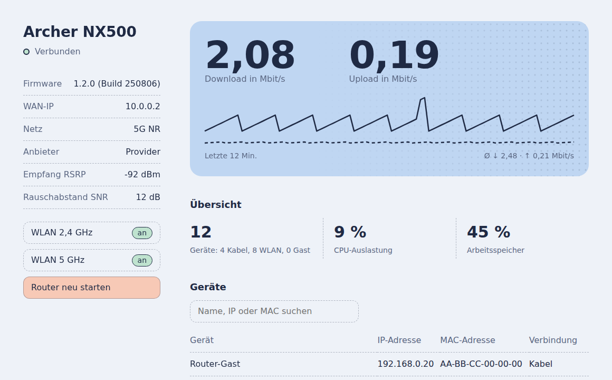

# GWAY

[](https://github.com/K0RBI02/GWAY/actions/workflows/lint.yml)


[](LICENSE)

A lightweight, private web UI for the **TP-Link Archer NX500** 5G router, packaged as a Home Assistant add-on.



> The screenshot uses anonymized sample data. Provider names, IP addresses and device details have been replaced or hidden.

## Features

- **Live traffic** with history graph, hover details and long-term averages
- **Overview tiles:** connected devices, CPU, memory and data usage (optional monthly limit with progress bar)
- **5G signal:** RSRP as dBm or rating, optional experimental SNR
- **Devices:** client list and static IP assignments (DHCP reservations)
- **Port forwarding:** list, add and delete rules
- **Controls:** toggle Wi-Fi and guest Wi-Fi (both bands at once or per band), reboot the router
- **Comfort:** click an IP or MAC address to copy it, light and dark mode, mobile layout
- **Languages:** English and German (follows the browser, switchable in the settings)
- **MQTT:** optional Home Assistant sensors via automatic discovery

## Installation

[](https://my.home-assistant.io/redirect/supervisor_add_addon_repository/?repository_url=https%3A%2F%2Fgithub.com%2FK0RBI02%2FGWAY)

1. In Home Assistant open **Settings → Add-ons → Add-on Store → ⋮ → Repositories** and add
   `https://github.com/K0RBI02/GWAY` (or use the button above).
2. Install **GWAY**.
3. Enter the router address and admin password in the configuration (optionally the data limit and reset day).
4. Start the add-on and open `http://<home-assistant-ip>:8480`.

## Configuration

| Option | Default | Description |
|---|---|---|
| `router_host` | `https://192.168.0.1` | Router address including `https://` |
| `router_password` | – | Router admin password |
| `poll_seconds` | `8` | Polling interval, 4–60 seconds |
| `data_limit_gb` | `0` | Monthly data limit in GB (`0` = no limit) |
| `data_reset_day` | `1` | Day of the month the data counter restarts (1–28) |

Full details on data usage, port forwarding, settings, storage and MQTT are in the add-on documentation: [src/DOCS.md](src/DOCS.md). All changes are listed in the [changelog](src/CHANGELOG.md).

## Security

GWAY has **no login**. Anyone who can reach port 8480 can switch Wi-Fi off, change port forwarding or reboot the router. Use it on your home network only and never expose the port to the internet. See [SECURITY.md](SECURITY.md).

## Compatibility

- Tested only with the **Archer NX500**. Other models may need a different client class.
- The router allows only one admin session at a time; while you are logged in to the router's own web interface, GWAY may be unable to connect. It reconnects automatically.
- Port forwarding is only tested against the mobile WAN interface (`MBB`).

## Development

```text
.
├── repository.yaml          # Home Assistant add-on repository metadata
├── docs/                    # README assets
└── src/                     # the add-on itself
    ├── config.yaml          # add-on manifest (version, options, schema)
    ├── Dockerfile
    ├── server.py            # HTTP server, router poller, API
    ├── mqtt.py              # optional MQTT discovery and publishing
    ├── static/index.html    # single-page web UI
    ├── translations/        # configuration labels (en/de)
    ├── DOCS.md              # documentation shown in Home Assistant
    └── CHANGELOG.md
```

Run it locally without Home Assistant (outside the add-on, options come from environment variables):

```sh
pip install -r src/requirements.txt
ROUTER_HOST=https://192.168.0.1 ROUTER_PASSWORD=… GWAY_DATA=./data python3 src/server.py
```

Then open `http://localhost:8480`. MQTT stays disabled without the Supervisor.

Versions follow **major.feature.fix**: a new feature raises the middle number, a bug fix the last one. Every release updates `src/config.yaml` and `src/CHANGELOG.md` and gets a `vX.Y.Z` tag. See [CONTRIBUTING.md](CONTRIBUTING.md).

## Credits

Unofficial and not affiliated with TP-Link. Router access uses [`tplinkrouterc6u`](https://github.com/AlexandrErohin/TP-Link-Archer-C6U).

## License

[MIT](LICENSE) © 2026 Korbi
